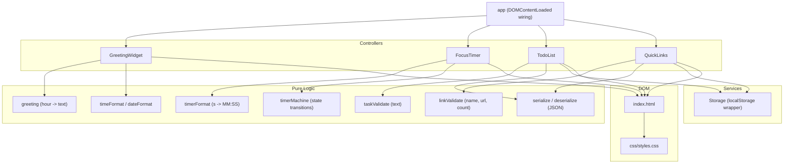
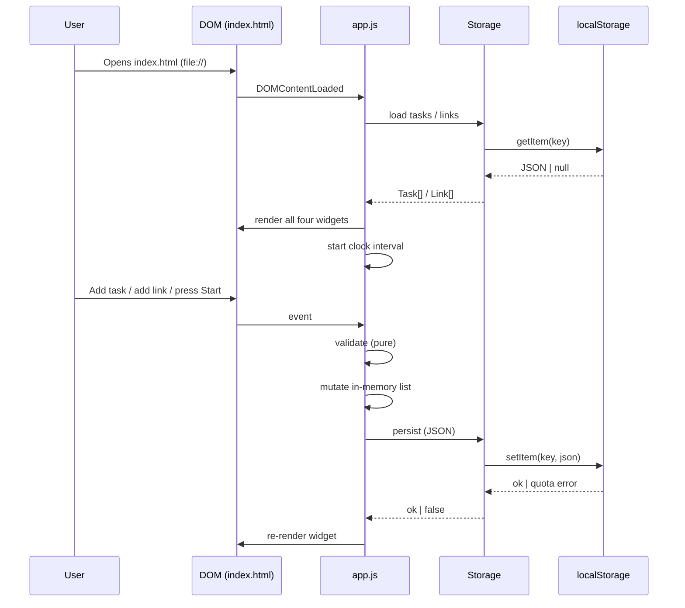
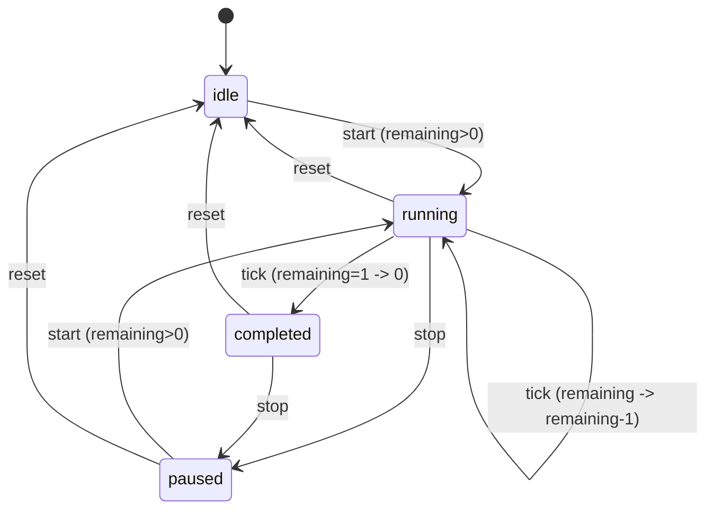

# Design Document

## Introduction

This design document describes the technical architecture and implementation approach for the **Todo List Life Dashboard**, a single-page web application built with vanilla HTML, CSS, and JavaScript. The Dashboard renders four widgets on a single view: a time-based Greeting Widget, a 25-minute Focus Timer, a persistent To-Do List, and a set of Quick Links. All user data is stored client-side using the browser Local Storage API. The application requires no backend server, no build step, and no external libraries.

The design separates pure, testable logic (greeting mapping, time formatting, timer state machine, validation, serialization) from impure concerns (DOM rendering, intervals, `window.open`, `localStorage` I/O). Pure logic is exposed on a single global namespace so it can be exercised by property-based tests in a jsdom environment without a build step.

## Overview

The Dashboard is a static site composed of exactly three source files:

- `index.html` — the single HTML document that links the stylesheet and script. It contains no inline styles and no inline scripts.
- `css/styles.css` — all styling for the four widgets, layout, and accessibility (contrast, spacing).
- `js/app.js` — all behavior in a single file, using a module/IIFE pattern to namespace logic and expose pure functions for testing.

At load time, the script registers a `DOMContentLoaded` listener that initializes each widget, loads persisted state from Local Storage, renders the current state to the DOM, and starts the clock interval for the Greeting Widget. The Focus Timer is ephemeral (not persisted); the To-Do List and Quick Links are persisted to Local Storage as JSON arrays on every mutation.

### Design Decisions and Rationale

- **Single global namespace over ES modules.** ES modules loaded over `file://` are blocked by CORS in some browsers (notably Chrome), which would violate the "open the HTML directly" requirement. A single IIFE exposing a `Dashboard` global avoids this while keeping behavior in one file.
- **Pure/impure separation.** Validation, formatting, state transitions, and serialization are implemented as pure functions with no DOM or storage access. This makes them suitable for property-based testing and keeps the rendering layer thin.
- **JSON arrays in Local Storage rather than IndexedDB.** The data volume is small (tasks and a capped set of 50 links) and the access pattern is whole-list read/write on mutation. Local Storage's key-value JSON model is the simplest match and satisfies all persistence requirements.
- **Storage wrapper with quota handling.** Every write goes through a `Storage.set` wrapper that catches `QuotaExceededError` and unavailability, returning a boolean so the UI can surface failures without crashing.

## Architecture

The application is organized into a thin DOM wiring layer and four widget controllers, all backed by a shared Storage service. Pure logic functions live in dedicated namespaces and have no dependencies on the DOM or storage; the controllers call them and apply the results to the DOM and storage.



### Component responsibilities

- **greeting** (pure): maps an hour (0-23) to one of four greeting strings.
- **timeFormat / dateFormat** (pure): map a `Date` to display strings.
- **timerFormat** (pure): maps seconds (0-1500) to an `MM:SS` string and parses back.
- **timerMachine** (pure): a state transition function over `{ status, remaining }` for start/stop/reset/tick.
- **taskValidate** (pure): validates task text, returning validity and an error key.
- **linkValidate** (pure): validates a quick link candidate against name, URL scheme, and count rules.
- **serialize / deserialize** (pure): JSON encode/decode for tasks and links.
- **Storage** (impure): reads/writes Local Storage, parsing JSON, swallowing quota/unavailability errors.
- **GreetingWidget** (impure): owns the clock interval; reads the system clock, formats, and updates DOM text; recomputes greeting on each tick.
- **FocusTimer** (impure): owns the countdown interval; applies `timerMachine` transitions, formats remaining time to the DOM, fires completion notification.
- **TodoList** (impure): renders the task list; applies `taskValidate`, mutates the in-memory list, persists via `Storage`, re-renders.
- **QuickLinks** (impure): renders link buttons; applies `linkValidate`, mutates the in-memory list, persists via `Storage`, re-renders; handles click-to-open.

### High-level data flow



## Components and Interfaces

All logic lives in one file (`js/app.js`) and is exposed on a single global `Dashboard` namespace (e.g., `window.Dashboard`). Pure functions are properties of sub-namespaces (`Dashboard.greeting`, `Dashboard.timerFormat`, etc.) so tests can load the file in jsdom and call them directly. DOM-dependent initialization runs only on `DOMContentLoaded`.

### Pure logic interfaces

```
Dashboard.greeting.getGreeting(hour: 0..23) -> "Good Morning" | "Good Afternoon" | "Good Evening" | "Good Night"
Dashboard.time.formatTime(date: Date) -> "HH:MM:SS"
Dashboard.time.formatDate(date: Date) -> "Weekday, Month Day, Year"
Dashboard.timerFormat.format(seconds: 0..1500) -> "MM:SS"
Dashboard.timerFormat.parse(display: "MM:SS") -> seconds
Dashboard.timer.transition(state, action) -> state   // state: {status, remaining}; action: "start"|"stop"|"reset"|"tick"
Dashboard.taskValidate(text: string) -> { valid: boolean, error: "empty"|"too_long"|null, trimmed: string }
Dashboard.linkValidate(name: string, url: string, count: number) -> { valid: boolean, error: "empty_name"|"empty_url"|"bad_scheme"|"limit"|null }
Dashboard.serialize.tasks(list: Task[]) -> string
Dashboard.serialize.parseTasks(json: string|null) -> Task[]
Dashboard.serialize.links(list: Link[]) -> string
Dashboard.serialize.parseLinks(json: string|null) -> Link[]
```

### Service interface

```
Dashboard.Storage.get(key: string) -> any | null            // JSON.parse result or null on missing/invalid
Dashboard.Storage.set(key: string, value: any) -> boolean  // true on success, false on quota/unavailable; never throws
Dashboard.Storage.remove(key: string) -> void
// Storage keys:
//   "tld.tasks" -> JSON array of Task
//   "tld.links" -> JSON array of Link
```

### Controller interfaces

```
Dashboard.GreetingWidget.init(rootEl: HTMLElement) -> void   // starts clock interval, renders
Dashboard.GreetingWidget.stop() -> void                     // clears interval
Dashboard.FocusTimer.init(rootEl: HTMLElement) -> void      // renders controls, sets state to idle/1500
Dashboard.FocusTimer.start() -> void
Dashboard.FocusTimer.stop() -> void
Dashboard.FocusTimer.reset() -> void
Dashboard.TodoList.init(rootEl: HTMLElement) -> void        // loads from Storage, renders
Dashboard.TodoList.addTask(text: string) -> {ok: boolean, error?: string}
Dashboard.TodoList.editTask(id: string, text: string) -> {ok: boolean, error?: string}
Dashboard.TodoList.toggleDone(id: string) -> void
Dashboard.TodoList.deleteTask(id: string) -> void
Dashboard.QuickLinks.init(rootEl: HTMLElement) -> void      // loads from Storage, renders
Dashboard.QuickLinks.addLink(name: string, url: string) -> {ok: boolean, error?: string}
Dashboard.QuickLinks.deleteLink(id: string) -> void
Dashboard.QuickLinks.openLink(id: string) -> void           // window.open(url, "_blank", "noopener")
```

### Timer state machine

The Focus Timer is modeled as a small state machine. The pure `Dashboard.timer.transition(state, action)` function is the single source of truth for state changes; the controller applies the result and schedules the tick interval.



State invariants enforced by `transition`:

- `reset` from any state yields `{ status: "idle", remaining: 1500 }`.
- `start` from `running` is a no-op (state unchanged).
- `start` from `idle`/`paused` with `remaining > 0` yields `{ status: "running", remaining }`.
- `start` from `idle`/`paused` with `remaining === 0` stays stopped (cannot start a finished timer without reset).
- `stop` from `running` yields `{ status: "paused", remaining }`.
- `tick` from `running` with `remaining > 1` decrements by 1 and stays `running`.
- `tick` from `running` with `remaining === 1` yields `{ status: "completed", remaining: 0 }` (controller fires the completion notification once).

## Data Models

### Task

A single to-do entry. Stored as an element of the JSON array at Local Storage key `tld.tasks`.

```json
{
  "id": "string",
  "text": "string (1..200 chars, trimmed)",
  "done": "boolean",
  "createdAt": "number (epoch ms)"
}
```

- `id`: unique identifier generated on creation (e.g., `crypto.randomUUID()` with a timestamp fallback).
- `text`: the user-entered label, stored after trimming leading/trailing whitespace; length constraint 1..200 applied at validation time on add and edit.
- `done`: completion status, toggled by the user; persisted on every change.
- `createdAt`: creation timestamp used only for stable ordering; not displayed.

### QuickLink

A single favorite website entry. Stored as an element of the JSON array at Local Storage key `tld.links`.

```json
{
  "id": "string",
  "name": "string (1+ chars, trimmed)",
  "url": "string (starts with http:// or https://)",
  "createdAt": "number (epoch ms)"
}
```

- `id`: unique identifier.
- `name`: display label, stored trimmed, must be non-empty.
- `url`: target URL, must start with `http://` or `https://`. The scheme check is a prefix match on the raw input before trimming the URL is stored.
- `createdAt`: creation timestamp used for stable ordering.
- At most 50 links may be stored; the 51st add is rejected by `linkValidate`.

### Timer state (ephemeral, not persisted)

```json
{ "status": "idle" | "running" | "paused" | "completed", "remaining": "number (0..1500, seconds)" }
```

- Initialized to `{ status: "idle", remaining: 1500 }` on load and on reset.
- Not persisted; reloading the page resets the timer to 25 minutes stopped.

### Local Storage schema

| Key         | Type        | Contents                          |
|-------------|-------------|-----------------------------------|
| `tld.tasks` | JSON string | Array of Task objects             |
| `tld.links` | JSON string | Array of QuickLink objects        |

- Missing or `null` keys are treated as empty arrays.
- Malformed JSON is treated as an empty array (parse failure handled in `deserialize`).

## Correctness Properties

*A property is a characteristic or behavior that should hold true across all valid executions of a system—essentially, a formal statement about what the system should do. Properties serve as the bridge between human-readable specifications and machine-verifiable correctness guarantees.*

The following properties cover the pure logic layers of the Dashboard. UI rendering, intervals, `window.open`, cross-browser rendering, and performance are covered by the example/integration/smoke tests described in the Testing Strategy and are not expressed as universal properties.

### Property 1: Greeting hour-to-text partition

*For any* hour `h` in `0..23`, `getGreeting(h)` equals exactly one of the four greeting strings, and the set of hours mapping to each greeting matches the requirement ranges exactly (Morning: 5-11, Afternoon: 12-16, Evening: 17-20, Night: 0-4 and 21-23), so the four ranges partition `0..23` with no gaps or overlaps.

**Validates: Requirements 2.1, 2.2, 2.3, 2.4, 2.5**

### Property 2: Time and date formatting

*For any* `Date` value, `formatTime(date)` produces a string matching `/^\d{2}:\d{2}:\d{2}$/` whose numeric components equal the date's hours, minutes, and seconds, and `formatDate(date)` produces a string containing the numeric day, month, and year of that date.

**Validates: Requirements 1.1, 1.2**

### Property 3: Timer MM:SS formatting round trip

*For any* integer `s` in `0..1500`, `timerFormat.format(s)` matches `/^\d{2}:\d{2}$/` and `timerFormat.parse(timerFormat.format(s))` equals `s`.

**Validates: Requirements 3.2**

### Property 4: Timer reset is total

*For any* timer state `st` (any status, any remaining in `0..1500`), `transition(st, "reset")` equals `{ status: "idle", remaining: 1500 }`.

**Validates: Requirements 3.1, 4.3**

### Property 5: Timer stop preserves remaining

*For any* timer state `st` with `status === "running"` and `remaining` in `0..1500`, `transition(st, "stop")` equals `{ status: "paused", remaining: st.remaining }`.

**Validates: Requirements 4.2**

### Property 6: Timer start is idempotent while running

*For any* timer state `st` with `status === "running"`, `transition(st, "start")` equals `st` (state and remaining unchanged).

**Validates: Requirements 4.4**

### Property 7: Timer tick decrements to zero and stops

*For any* timer state `st` with `status === "running"` and `remaining > 1`, `transition(st, "tick")` equals `{ status: "running", remaining: st.remaining - 1 }`; and when `status === "running"` and `remaining === 1`, `transition(st, "tick")` equals `{ status: "completed", remaining: 0 }`, after which the controller stops counting.

**Validates: Requirements 3.3, 4.1, 4.5**

### Property 8: Task text validation boundaries

*For any* string `s`, `taskValidate(s).valid` is true if and only if the length of `s` after trimming leading and trailing whitespace is between 1 and 200 inclusive; when the trimmed length is 0 the error is `"empty"`, and when the trimmed length exceeds 200 the error is `"too_long"`; `taskValidate(s).trimmed` equals `s.trim()`.

**Validates: Requirements 5.1, 5.2, 5.5, 5.6, 5.7**

### Property 9: Adding a valid task grows the list with trimmed text

*For any* task list `L` and any string `s` with trimmed length in `1..200`, after `addTask(L, s)` the resulting list length is `L.length + 1` and the new entry's `text` equals `s.trim()`.

**Validates: Requirements 5.1**

### Property 10: Editing a task updates text and preserves count

*For any* task list `L`, any existing task `id` in `L`, and any string `s` with trimmed length in `1..200`, after `editTask(L, id, s)` the list length is unchanged, the task with that `id` has `text` equal to `s.trim()`, and all other tasks are unchanged.

**Validates: Requirements 5.2**

### Property 11: Task completion toggle is an involution

*For any* task list `L` and any task `id` in `L`, toggling the done status of that task twice restores the original done value, and the list length and all `text` values are unchanged.

**Validates: Requirements 5.3**

### Property 12: Task deletion is idempotent and removes the target

*For any* task list `L` and any `id` (present or not), applying `deleteTask` with that `id` twice yields the same list as applying it once; if `id` was present, the resulting list has length `L.length - 1` and no longer contains that `id`; if `id` was absent, the list is unchanged.

**Validates: Requirements 5.4**

### Property 13: Task serialization round trip

*For any* task list `L`, `parseTasks(serialize(L))` deep-equals `L`; and `parseTasks(null)` and `parseTasks("[]")` both equal the empty list.

**Validates: Requirements 6.1, 6.2, 6.3, 10.1, 10.3**

### Property 14: Quick link validation rules

*For any* `name`, `url`, and current count `c`, `linkValidate(name, url, c).valid` is true if and only if all of the following hold: `name.trim()` is non-empty, `url.trim()` is non-empty, `url` starts with `"http://"` or `"https://"`, and `c < 50`; otherwise the error identifies the first failing rule.

**Validates: Requirements 7.4**

### Property 15: Quick link serialization round trip

*For any* link list `L`, `parseLinks(serialize(L))` deep-equals `L`; and `parseLinks(null)` and `parseLinks("[]")` both equal the empty list.

**Validates: Requirements 8.1, 8.2, 8.3, 10.1, 10.3**

### Property 16: Quick link deletion is idempotent and removes the target

*For any* link list `L` and any `id` (present or not), applying `deleteLink` with that `id` twice yields the same list as applying it once; if `id` was present, the resulting list has length `L.length - 1` and no longer contains that `id`; if `id` was absent, the list is unchanged.

**Validates: Requirements 7.3**

### Property 17: Storage write failure does not throw

*For any* key and value, when the underlying `localStorage.setItem` throws (quota exceeded or unavailable), `Storage.set(key, value)` returns `false` and does not throw.

**Validates: Requirements 10.4**

## Error Handling

- **Invalid task text.** `addTask` and `editTask` run `taskValidate` before mutating state. On failure they render an inline error message (empty or too-long), keep the in-memory list and Local Storage unchanged, and return `{ ok: false, error }`. The error message is cleared on the next valid submission or on input focus.
- **Invalid quick link.** `addLink` runs `linkValidate` (empty name, empty URL, bad scheme, or count at 50). On failure it renders an inline error message, keeps the list and storage unchanged, and returns `{ ok: false, error }`.
- **Local Storage quota/unavailability.** Every write goes through `Storage.set`, which wraps `localStorage.setItem` in `try/catch`. On `QuotaExceededError` or any thrown error it returns `false`. Controllers check the return value and, on failure, render a non-blocking toast/banner reading "Storage full — changes could not be saved" without crashing or discarding the in-memory update from the view.
- **Malformed persisted data.** `Storage.get` wraps `JSON.parse` in `try/catch`; a missing key or a parse failure returns `null`, which `parseTasks`/`parseLinks` normalize to an empty array. This prevents a corrupt store from breaking load.
- **Timer completion.** When `remaining` reaches 0 the controller transitions to `completed`, stops the interval, displays `00:00`, and fires the notification exactly once. Audio playback is wrapped in a user-gesture-aware guard (the notification is armed on Start so the completion beep can play per browser autoplay rules) and wrapped in `try/catch` so an unsupported audio element does not crash the app.
- **Window open.** `openLink` calls `window.open(url, "_blank", "noopener")` and guards against popup blockers by not assuming a return value; a blocked popup leaves the existing UI intact.

## Testing Strategy

### Dual testing approach

- **Property-based tests** validate the universal properties of the pure logic layers across many generated inputs.
- **Unit tests** validate specific examples, edge cases, and integration points between controllers and pure logic.
- **Integration/smoke tests** validate DOM wiring, persistence round trips against a fake Local Storage, intervals, `window.open`, and load behavior.

### Property-based testing setup

- **Library:** `fast-check` (well-maintained, framework-agnostic property-based testing for JavaScript).
- **Runner:** Vitest with the `jsdom` environment (or Node's built-in test runner with jsdom). The app's single `js/app.js` is loaded into the jsdom context; pure functions are reached via the `window.Dashboard.*` namespace.
- **Iteration count:** every property test runs a minimum of 100 iterations.
- **Test tagging:** each property test carries a comment in the form `Feature: todo-list-life-dashboard, Property N: <property text>` matching the design property it validates.
- **One test per property:** each correctness property is implemented as a single property-based test using `fast-check`'s `fc.assert(fc.property(...))`.

### Property tests (map to Correctness Properties 1-17)

- Property 1: generate hours `0..23`; assert partition and per-range greeting.
- Property 2: generate random `Date` values; assert formatted time/date contents and components.
- Property 3: generate `s` in `0..1500`; assert format/parse round trip.
- Properties 4-7: generate random timer states; assert transition results.
- Property 8: generate arbitrary strings; assert validation validity and error keys against trimmed length.
- Properties 9-12: generate random task lists and ids; assert add/edit/toggle/delete invariants.
- Property 13: generate random task lists; assert serialize/parse round trip and empty cases.
- Property 14: generate arbitrary name/url/count; assert validation conjunction.
- Properties 15-16: generate random link lists; assert round trip and idempotent deletion.
- Property 17: inject a fake `localStorage` whose `setItem` throws; assert `Storage.set` returns `false` and does not throw.

### Unit tests (examples and edge cases)

- Greeting: `getGreeting(5)==="Good Morning"`, `(12)==="Good Afternoon"`, `(17)==="Good Evening"`, `(0)==="Good Night"`, `(23)==="Good Night"`.
- Timer format: `format(0)==="00:00"`, `format(1500)==="25:00"`, `format(1507)` invalid bounds handling.
- Task validation: empty string, all-whitespace string, 200-char boundary (valid), 201-char (invalid), leading/trailing whitespace trimmed.
- Link validation: valid `https://` and `http://`; invalid `ftp://`, `javascript:`, empty name, empty URL, and count exactly 50.
- Controller integration: `TodoList.addTask` updates the rendered DOM and persists to the fake Local Storage; `QuickLinks.addLink` appends a button and persists.
- Completion: `FocusTimer` reaching zero transitions to `completed`, displays `00:00`, and triggers the notification once.

### Integration / smoke tests

- **Load:** `DOMContentLoaded` initializes all four widgets; with empty Local Storage, zero tasks and zero links render with no errors (Requirements 6.3, 8.3, 10.3).
- **Persistence round trip:** write tasks/links, reload via re-init, assert restored state matches (Requirements 6.1, 6.2, 8.1, 8.2).
- **Clock interval:** assert an interval with delay `<= 1000` ms is registered and updates the time element (Requirements 1.1, 1.3).
- **Open in new tab:** mock `window.open`; clicking a link calls it with the URL and `"_blank"` (Requirement 7.2).
- **Quota failure:** fake `localStorage.setItem` throws; assert no crash and a user-facing message appears (Requirement 10.4).
- **Structure (smoke):** `index.html` links `css/styles.css` and `js/app.js`; no inline `<style>` or inline `<script>` bodies; no external framework references (Requirements 9.1-9.4); the HTML loads and all widgets render when opened via `file://` (Requirement 11.2).
- **Performance (smoke):** time-to-render under 2s on load; each task/link operation under 300ms (Requirements 12.1-12.3).
- **Accessibility (smoke):** computed font-size `>= 16px` and contrast `>= 4.5:1` for time, date, greeting, tasks, and link names; distinct, non-overlapping widget boundaries (Requirements 13.1-13.3).

### Browser compatibility testing

Manual verification across the two most recent major versions of Chrome, Firefox, Edge, and Safari: open `index.html` via `file://`, confirm all widgets render without layout errors and the console reports no errors, then exercise each interactive feature (Requirement 11.1). Full WCAG validation requires manual testing with assistive technologies and expert accessibility review.

### Why property-based testing applies here

The Dashboard contains substantial pure logic — hour-to-greeting mapping, time formatting, timer state transitions, input validation, and JSON serialization — where behavior varies meaningfully with input and where 100+ generated iterations are cheap (in-memory, no external calls). These are exactly the conditions under which property-based testing adds value over a handful of example cases. UI rendering, layout, cross-browser behavior, and performance are not suitable for PBT and are handled by integration and smoke tests as described above.
